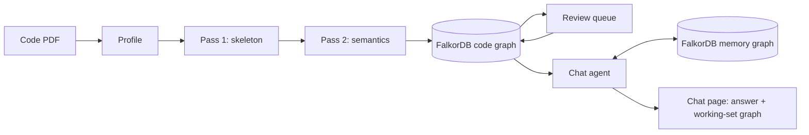

# CiteWise

**Ask any code a question. Every answer cited, every number checked.**

Turn a digital building-code PDF into a FalkorDB graph, then ask design questions and get
answers that walk the graph clause by clause, with every number computed by code and every
claim cited to its clause, table, equation and page.

Built for **Graph Hacks** (WeMakeDevs × FalkorDB).
Tracks: Agents That Act on Connected Data · Company Brain · Agent Memory and Coordination.

> **Demo video:** _[link to the demo video]_
>
> _[screenshot: chat with the working-set graph and citation chips]_
> _[screenshot: review queue, a table before and after]_
> _[screenshot: library and ingestion report]_

---

## What it does, and why a graph

Building codes are not prose to be summarised. They are a web of provisions: a clause
requires another clause, an equation uses a parameter that a table gives, a table row
applies only under conditions stated in its label cells and its footnotes, and commentary
explains a provision without changing it. An engineer answering "what is the pseudo
lateral load for my building?" follows that web: Equation 3-10, its six inputs, Table 3-1
for C<sub>m</sub>, the clause that says C<sub>2</sub> is 1.0 for linear procedures, and so on.

A plain LLM answering the same question will often skip a clause, use a value from a
different edition, or do the arithmetic wrong, and it cannot show where an answer came
from. This project keeps the code's structure explicit:

- **The graph holds every fact.** Clauses, equations, tables, rows, parameters, terms and
  the references between them are nodes and edges in FalkorDB, each with its page, source
  quote, extraction method and review status.
- **The agent walks the graph.** It finds entry points, follows dependencies, matches table
  rows, and computes with SymPy. It never does arithmetic in its own text, and it cites what
  it walked.
- **You can see the path.** The chat page draws the nodes the agent touched as it works and
  turns the answer's path bold. Every citation opens the source: clause text, the equation
  crop beside its LaTeX, the table row, and the PDF page.

On FEMA 356 (518 pages) the graph holds 1,883 clauses, 236 equations, 101 tables with 2,022
rows, 747 parameters, 237 terms and 2,989 references; Pass 1 covers 99.5% of the text.

## Architecture



**Core principle: Claude decides what generalises; code verifies; FalkorDB holds every fact.**
Claude (through the API) makes the judgments that need reading: the document's heading
rules, the meaning of a clause, symbols in an equation image, a table's structure. Deterministic
Python applies those judgments and checks every result before it is written. Nothing reaches
the graph or an answer without passing a check.

1. **Profile** (`app/profile/`). Claude reads a sample of pages and proposes the document's
   rules: heading levels and numbering, caption, equation-number and footnote patterns,
   running headers and footers, streams (provisions, commentary). Code validates the profile
   against the whole PDF (coverage, ordering, hierarchy, reference coverage) and asks Claude
   to revise when a check fails. No pattern from any one code is hard-coded.
2. **Pass 1, skeleton** (`app/ingest/pass1/`). PyMuPDF and the profile segment the PDF into
   clauses, equations (with image crops), tables (grids from PyMuPDF `find_tables()` or
   Docling, with crops), figures, footnotes and references; lines the font cannot decode
   are flagged. Written to FalkorDB with `UNWIND … MERGE`, so re-runs never duplicate.
3. **Pass 2, semantics** (`app/ingest/pass2/`). One validated Claude call per notation page,
   clause and table, in parallel, cached by input, schema and prompt version:
   - clauses → parameters, equations (LaTeX read from the image, a SymPy form), conditions,
     requirements, exceptions, typed references, and character-level symbol corrections;
   - tables → header parameters, each row's conditions and values, footnote rules,
     blank-cell readings.

   Every answer is parsed with Pydantic, then checked: source quotes must appear in the
   text; equations must parse in SymPy and their LaTeX and SymPy forms must agree
   numerically; table numbers must match the text layer (or, for image-trust tables, a
   second independent read); every value must sit in a column a header names; every row
   and every printed number must be in the answer; no control or garbled characters. A
   failing answer is retried once with the problems listed, then stored as flagged.
4. **Search indexes** (`app/graph/search_index.py`). Full-text indexes on clauses,
   parameters, terms and tables, and local sentence-transformers embeddings (offline, no
   API) in FalkorDB vector indexes.
5. **Review queue** (`app/api/review_routes.py`, `web/review.html`). Flagged items, highest
   severity first. Approve, or reject with a note: the job re-runs on the review model with
   the note, and the new answer replaces the old only if it passes. A reject that says the
   grid is wrong first rebuilds the table's grid from the image, checked against every
   number in the text layer, and rolls it back if the new answer is not kept.
6. **Chat agent** (`app/agent/`). Claude (`MODEL_AGENT`) with plain-Python tools over the
   code graph:

   | Tool | What it does |
   | --- | --- |
   | `find_entry` | Exact id/symbol/alias match, full-text and vector search, merged by rank fusion |
   | `get_dependencies` | Upstream (what a node needs) or downstream (what uses it) |
   | `applicable_clauses` | A clause and its sub-clauses, conditions checked against the session facts |
   | `get_clause` | Clause text, typed references, equations with crops; for a table: columns, row conditions, footnotes and notes (no values) |
   | `compute` | The only source of numbers: evaluates equations in SymPy from session facts; matches table rows, maps columns, interpolates when a footnote allows; reports missing inputs; refuses equations flagged high |
   | `calculate` | For values `compute` cannot map: every input cited (cell with row, column, value and header, or a fact), every citation checked against the graph, arithmetic in SymPy; interpolation needs a cited note that permits it |
   | `plan_procedure` | Ordered steps to a goal (dependencies first), inputs known and missing, and the decisions that change the path |
   | `save_session_facts` | Writes project facts to the memory graph; a changed fact re-runs the last answer |
   | `trace` | Clause, table, row, equation and page citations for the answer path |
   | `run_cypher` | Read-only Cypher, 200 rows, 3 s timeout, code graph only; table values hidden |

   After each answer, code checks it: labels the tools attached (unreviewed, inferred,
   assumed, inputs selected by agent) must appear, and every number must be found in a tool
   result, a fact or the user's words; warnings are shown under the answer.
7. **Memory** (`app/memory/graph.py`). A separate FalkorDB graph per user: sessions,
   messages, facts as `ASSUMES` edges (value, unit, source), matched rows, and each
   question's answer path. A changed fact (in chat or the facts panel) re-runs the stored
   path and leads the new answer with a change line, for example
   `Changed: W 1500 → 2000 kips. V 1069.2 → 1425.6 kips; same path (Equation 3-10).`

## Graph data model

One FalkorDB graph per code document (`code_<name>`), one memory graph (`memory`). Every
code-graph node carries `page`, `bbox`, `source_quote`, `confidence`, `extraction_method`,
`review_status` and `schema_version`; Pass 2 results also carry `status`
(`skeleton` / `extracted` / `flagged`) and `flags`.

**Code graph nodes**

| Label | What it is |
| --- | --- |
| `Document` | The code: title, edition, jurisdiction, page count, coverage |
| `Clause` | A numbered provision or commentary section: number, title, text (and corrected text), depth, stream |
| `Equation` | A numbered or inline equation: raw text, crop, LaTeX, SymPy form |
| `WhereItem` | One line of an equation's "where" block |
| `Parameter` | A symbol: id (also its SymPy name), LaTeX, description, units, aliases |
| `Term` | A defined term and its definition |
| `Table` | Caption, pages, crops, trust (`text` / `image`) |
| `Row` | A grid row: Pass 1 cells, Pass 2 conditions and values |
| `Footnote` | Marker, text, and its rule (interpolation, condition, override, note) |
| `Figure`, `ExternalCode` | Figures; codes referenced but not ingested (e.g. ACI 318) |
| `Condition`, `Requirement`, `Exception` | Parts of a clause, as Pass 2 read them |
| `SymbolCorrection` | Raw and corrected text where the text layer misread a symbol |
| `FlaggedLine` | A line the font could not decode, with its reasons |

**Code graph edges**

| Edge | From → to | Meaning |
| --- | --- | --- |
| `PART_OF`, `NEXT` | Clause → Clause / Document | Hierarchy and reading order |
| `REFERENCES` {text, type} | Clause → Clause / Table / Equation / Figure / ExternalCode | A cited reference; `type` is `requires`, `uses_value_from`, `modifies`, `exception_to`, `alternative_to` or `see_also` |
| `CONTAINS` | Clause → Equation / Table / Figure | Where an object is printed |
| `COMPUTES`, `USES` | Equation → Parameter | Left-hand side; right-hand side inputs |
| `WHERE` | Equation / Clause → WhereItem | Definitions printed with the equation |
| `DEFINES`, `DEFINED_IN` | Clause → Parameter, Parameter → Clause | Where a symbol is defined |
| `GIVES` {cols, header_text, units} | Table → Parameter | A table column's quantity |
| `HAS_ROW` {index}, `HAS_FOOTNOTE`, `FOOTNOTE` | Table → Row / Footnote, Row → Footnote | Table structure |
| `HAS_CONDITION`, `HAS_REQUIREMENT`, `HAS_EXCEPTION`, `HAS_CORRECTION`, `HAS_FLAG` | Clause / Table → … | Clause parts, corrections, flagged lines |
| `USES_TERM` | Clause → Term | A defined term used in a clause |
| `COMMENTARY_ON` | Clause → Clause | Commentary section → provision |

**Memory graph**

```
(:Session {id, code})-[:HAS_MESSAGE]->(:Message {n, role, text})
(:Session)-[:ASSUMES {value, unit, source, label}]->(:Parameter|:Descriptor {key, id, graph})
(:Session)-[:MATCHED {reason}]->(:Row {key, id, graph, table})
(:Session)-[:ASKED]->(:Question {text, answer, calls, tools, warnings})-[:ANSWERED_VIA {order}]->(stub)
```

Fact sources: `user`, `matched_row` (a value `compute` mapped from a matched row),
`assumed` (a typical value the user accepted), `agent_selected` (a value the agent picked).
Memory nodes point to code-graph nodes by id; the code graph is never written by the agent.

## Key Cypher queries

Fixed queries the tools run (`app/agent/`); `run_cypher` uses FalkorDB's read-only mode.

Find candidates by full text and by vector (rank-fused with exact matches):

```cypher
CALL db.idx.fulltext.queryNodes('Clause', $q) YIELD node, score
RETURN node ORDER BY score DESC LIMIT 8

CALL db.idx.vector.queryNodes('Parameter', 'embedding', 8, vecf32($v)) YIELD node, score
RETURN node ORDER BY score ASC
```

What a parameter depends on (upstream), one hop at a time:

```cypher
MATCH (x:Equation)-[e:COMPUTES]->(n:Parameter {id: $id}) RETURN x, e
MATCH (x:Table)-[e:GIVES]->(n:Parameter {id: $id}) RETURN x, e
MATCH (n:Equation {id: $id})-[e:USES]->(x:Parameter) RETURN x, e
MATCH (n:Clause {id: $id})-[e:REFERENCES]->(x)
WHERE e.type IN ['requires', 'uses_value_from'] RETURN x, e
```

What a change affects (downstream), for example "which clauses change if κ drops":

```cypher
MATCH (x:Equation)-[:USES]->(:Parameter {id: $id}) RETURN x
MATCH (x:Clause)-[:REFERENCES]->(:Equation {id: $id}) WHERE … RETURN x
```

An equation to evaluate, with its clause and inputs:

```cypher
MATCH (c:Clause)-[:CONTAINS]->(e:Equation {id: $id}) RETURN c, e
MATCH (:Equation {id: $id})-[:USES|COMPUTES]->(p:Parameter) RETURN p
```

A table's columns and rows for row matching:

```cypher
MATCH (:Table {id: $id})-[e:GIVES]->(p:Parameter)
RETURN p.id, coalesce(e.cols, [e.col]), e.header_text, e.units ORDER BY e.col
MATCH (:Table {id: $id})-[:HAS_ROW]->(r:Row) WHERE r.values IS NOT NULL RETURN r
MATCH (:Table {id: $id})-[:HAS_FOOTNOTE]->(f:Footnote) RETURN f
```

A clause and its sub-clauses with their conditions:

```cypher
MATCH (s:Clause {id: $id}) OPTIONAL MATCH (k:Clause)-[:PART_OF*1..4]->(s)
WITH s, collect(DISTINCT k) AS ks RETURN [s] + ks
MATCH (:Clause {id: $id})-[:HAS_CONDITION]->(x) RETURN x.text
```

The facts block injected into every agent call:

```cypher
MATCH (:Session {id: $s})-[a:ASSUMES]->(n)
RETURN n.id, a.value, a.unit, a.source, a.label ORDER BY a.updated
```

## Setup

Requirements: Python 3.11+, Docker Desktop, an Anthropic API key (Console credits), and
FalkorDB 4.22.1 or newer (graph module 42201). `docker-compose.yml` pins
`falkordb/falkordb:v4.22.1` by digest, the version the graph was built and tested on.
The commands are for Windows PowerShell; on macOS or Linux use `source .venv/bin/activate`.

On Windows, two scripts do the same in one step each: `install.bat` (finds Python 3.11+,
creates `.venv`, installs the requirements, copies `.env.example` to `.env`, pulls the
FalkorDB image) and `launch.bat` (starts Docker Desktop if needed, `docker compose up -d`,
then the app on http://127.0.0.1:8000/ and opens it; `APP_PORT` and `NO_BROWSER=1` change
that). Set `ANTHROPIC_API_KEY` in `.env` between the two.

```powershell
git clone https://github.com/yUtkarsh/citewise.git; cd citewise
docker compose up -d                      # FalkorDB on :6379, its browser UI on http://localhost:3000
python -m venv .venv; .\.venv\Scripts\Activate.ps1
pip install -r requirements.txt
Copy-Item .env.example .env               # then set ANTHROPIC_API_KEY
```

### Load the prebuilt FEMA 356 graph (no PDF, no API spend)

`export/` holds the finished FEMA 356 graph as a FalkorDB dump (12,932 nodes, 21,217 edges,
6.8 MB gzipped), with indexes and embeddings, and a manifest of its checksum and counts. With
FalkorDB running and the requirements installed:

```powershell
python -m scripts.load_graph
```

This restores `code_fema356` and checks the checksum before loading and the node and edge
counts after. It refuses to overwrite an existing `code_fema356` unless you pass `--replace`.
It needs a FalkorDB graph module at the export's version (`falkordb_graph_module` in the
manifest) or newer: `docker compose pull` updates an older image. The library, review page
and FalkorDB browser UI (http://localhost:3000) then show the graph; chat at
`chat.html?graph=code_fema356` also needs `ANTHROPIC_API_KEY`. Equation, table and clause
crop images are files, not graph data: they ship as `export/code_fema356_crops.zip` (443
PNGs, 23 MB), which the loader checks against the manifest and unpacks into
`data/crops/code_fema356/`, keeping files already there. To re-export after rebuilding
(dump, manifest and crops zip): `python -m scripts.export_graph --code fema356`.

`.env` (never committed; loaded by the app with python-dotenv, not exported to the shell):

| Variable | Default | Used for |
| --- | --- | --- |
| `ANTHROPIC_API_KEY` | | Claude API |
| `MODEL_PROFILE`, `MODEL_NOTATION`, `MODEL_TABLES` | `claude-sonnet-5-5` | Profile, notation pages, tables |
| `MODEL_CLAUSES` | `claude-haiku-5-5` | Clause extraction |
| `MODEL_AGENT`, `MODEL_REVIEW` | `claude-sonnet-5-5` | Chat agent; review re-runs and grid rebuilds |
| `AGENT_EFFORT` | `medium` | Agent effort |
| `CLAUSE_CROPS` | `always` | Send clause crops with every clause call, or only for flagged lines |
| `EMBED_MODEL` | `BAAI/bge-small-en-v1.5` | Local embeddings (downloaded once, then offline) |
| `FALKORDB_HOST`, `FALKORDB_PORT` | `localhost`, `6379` | FalkorDB |
| `CHAT_MAX_COST`, `REVIEW_MAX_COST`, `UPLOAD_MAX_COST` | 1.0, 1.0, 3.0 | USD caps per chat session, per reject, per upload |

## Running it

**Web app** (library, upload, chat, review):

```powershell
uvicorn app.api.main:app --reload        # http://127.0.0.1:8000/
```

- **Library** (`/`): one card per ingested code, with recent chats.
- **Upload**: drop a PDF; confirm the profile Claude proposed (title, edition, headings),
  then watch Pass 1 and Pass 2 fill the graph; the ingestion report shows counts, coverage,
  flags by severity, symbol warnings and cost.
- **Chat** (`chat.html?graph=code_fema356`): ask a question; tool steps stream in, the
  working-set graph fills, citations open the source panel. Edit a value in the facts panel
  to re-run the last answer with a change line.
- **Review** (`review.html?graph=code_fema356`): flagged items by severity; approve, or
  reject with a note (tick "the grid is wrong" for a table whose grid is broken).

**Command line:**

```powershell
python -m app.ingest.run data/fema356.pdf --pass1                    # profile + skeleton
python -m app.ingest.run data/fema356.pdf --pass2 --max-cost 9       # semantics (--dry-run estimates)
python -m app.graph.search_index --code fema356                      # full-text and vector indexes
python -m app.agent.chat --code fema356 --max-cost 1                 # chat in the terminal
python -m app.agent.chat --code fema356 --script scripts/phase4_questions.txt
python -m scripts.recheck_tables data/fema356.pdf                    # re-run table checks, no API calls
python -m scripts.cleanup_orphans --code fema356 --dry-run           # leftover parameters
```

Useful Pass 2 options: `--pages 120-140`, `--chapters 2,3`, `--tables "Table 6-7|Table 6-19"`,
`--clauses`, `--jobs notation,definitions,clauses,tables`, `--redo`, `--no-cache`, `--hint`.

**Cost and time on FEMA 356 (518 pages):** Pass 1 about 1.5 minutes; Pass 2 about
11 minutes at 12 parallel calls and about $6; embeddings about 3 minutes on CPU; a chat
answer typically $0.02–0.08.

## Tests

```powershell
pytest -q                 # about 320 tests; uses FalkorDB when it is running, else those tests skip
$env:RUN_SLOW = "1"; pytest -q tests/test_tables.py   # include the Docling test
```

Tests never call the API: Pass 2 and the agent run against scripted fake models, on public
fixture pages (`fixtures/`) and small synthetic graphs. Tests that need licensed pages
(`private_fixtures/`) skip when the files are absent. Most tests check document-independent
behaviour (ordering, coverage, numeric matches, refusals) rather than strings from one code.

## Data sources and licenses

- **FEMA 356**, *Prestandard and Commentary for the Seismic Rehabilitation of Buildings*
  (Federal Emergency Management Agency, November 2000), is a U.S. federal government
  publication distributed free of charge by FEMA. It is the demo document. Single-page
  excerpts used as test fixtures are committed in `fixtures/`; the full PDF is not committed
  (place it at `data/fema356.pdf`).
- **Licensed codes** (for example ASCE/SEI 41) were used only locally, to test that the
  pipeline generalises to a different layout. Their pages live in `private_fixtures/`, which
  is git-ignored, and no graph, crop, cache or report built from them is committed (`data/`
  is git-ignored). They are not part of the public demo.
- Embedding model: `BAAI/bge-small-en-v1.5` (MIT License), run locally.
- Libraries: FalkorDB, FastAPI, PyMuPDF, Docling, SymPy, sentence-transformers, Pydantic,
  Cytoscape.js and KaTeX, under their own licenses.

## Limitations

- **Digital PDFs only.** Scanned PDFs (no text layer) are not supported. Math in the text
  layer (primes, radicals, large brackets, stacked fractions) can extract wrongly, so
  equations and suspect table cells are read from image crops and checked; symbol-font
  problems are reported as warnings and flagged for review.
- **Two-way table lookups go through `calculate`.** `compute` matches rows by their
  conditions but has no per-column conditions, so a table chosen by a column header value
  (FEMA Table 1-4: F<sub>a</sub> by site class and S<sub>S</sub>) is read with `calculate`,
  which checks every cited cell, header and permitting note. Where the grid merged the header
  cells, a header is checked as present in the table's header but not as standing over the
  cited column; the result says so and is labelled "inputs selected by agent".
- **Merged cells can defeat a grid rebuild.** When one value spans several rows (ASCE
  Table 7.3.2b), the rebuilt grid repeats it while the extraction reads a blank "same as
  above"; the new answer then fails its check and the grid is rolled back. Such tables need
  a manual fix.
- **Not built from the global pass:** Claude linking of unmatched commentary (commentary is
  linked by number prefix only), inferred edges (the agent and labels support them, but none
  exist), and entity resolution beyond exact id and symbol match (no similarity tier or
  adjudication; duplicate parameters are not merged).
- **One user, no login.** The memory graph is single-user; reopening a past chat works, but
  there is no account system. A chat session stays on the code graph it started on.
- The agent can only be as complete as the graph: when a link is missing it says so rather
  than answering from memory, and it may then miss a step a human would take.

## AI-use disclosure

- **Built with Claude Code.** The code, tests and documentation in this repository were
  written with Claude Code (Anthropic), working from the spec in `SPEC.md` phase by phase,
  with the author reviewing plans, results and costs at each checkpoint.
- **The product uses the Claude API** (Anthropic): to propose the document profile, extract
  notation, clauses and tables in Pass 2, re-run rejected review items and rebuild table
  grids, and to run the chat agent. Every Claude output is validated with Pydantic and
  deterministic checks before it is stored, every number in an answer comes from code
  (SymPy), and answers are labelled where they rest on unreviewed, inferred, assumed or
  agent-selected inputs.
- Embeddings are computed locally with sentence-transformers; no other AI service is used.

## Repository layout

```
app/
  profile/      document profile: page map, Claude proposal, validation
  ingest/       pass1/ (skeleton), pass2/ (semantics, checks, grid revision)
  graph/        FalkorDB connection, schema, writers, search indexes
  agent/        tools, compute, calculate, procedure, loop, guard, CLI, web hook
  memory/       memory graph
  api/          FastAPI routes: chat (SSE), library and ingestion, sessions, review
  prompts/      one versioned file per Claude prompt
web/            static pages (Cytoscape.js, KaTeX); web/EVENTS.md is the chat event contract
scripts/        fixtures, font check, table recheck, orphan cleanup, graph export/load, checkpoint questions
export/         the FEMA 356 graph as a FalkorDB dump plus its crop images, for scripts.load_graph
tests/          pytest suite with fake models and synthetic graphs
fixtures/       public FEMA 356 pages
SPEC.md         the full spec, build order and known issues
```
