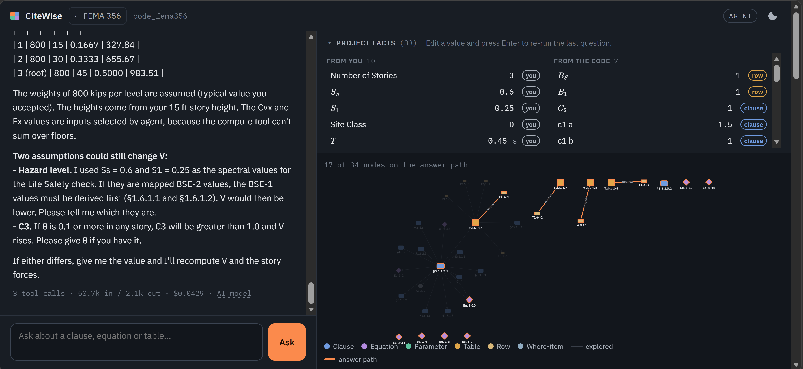
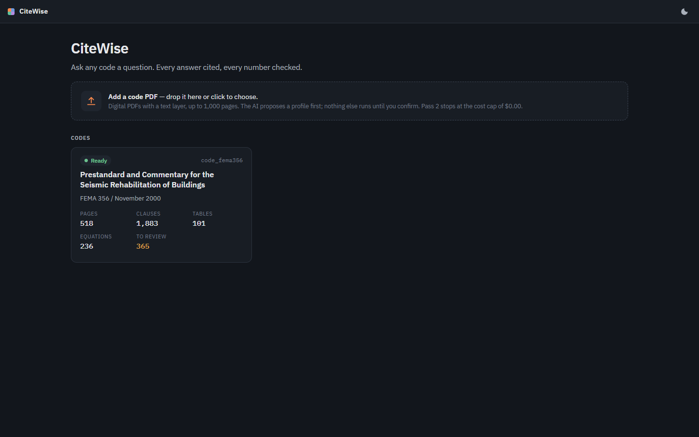
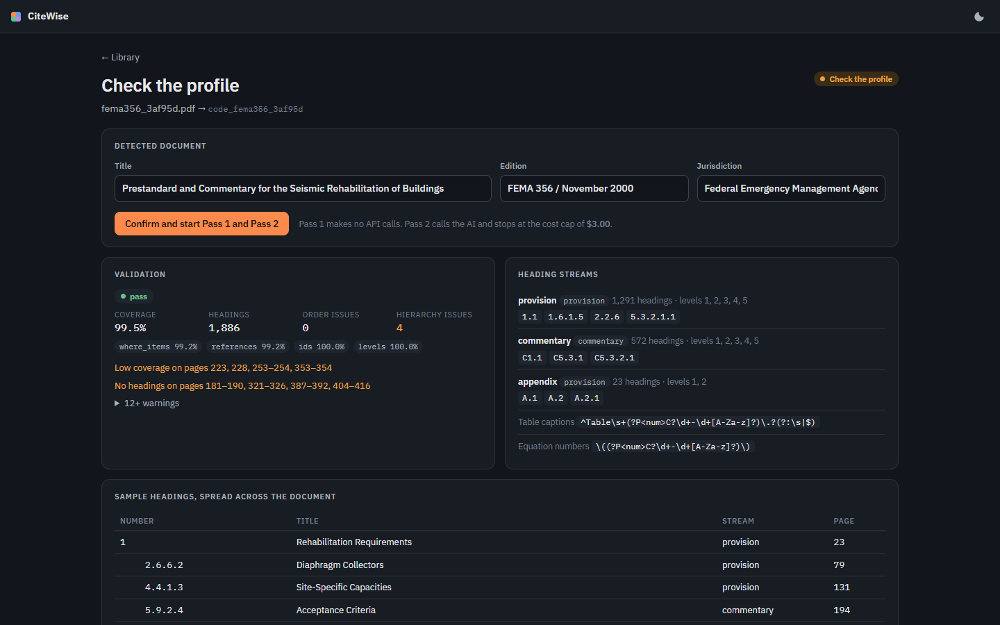
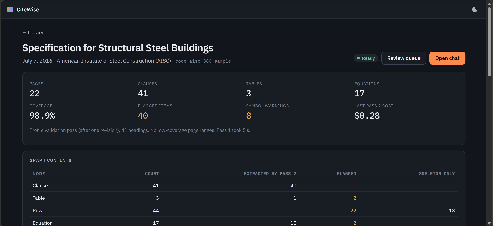
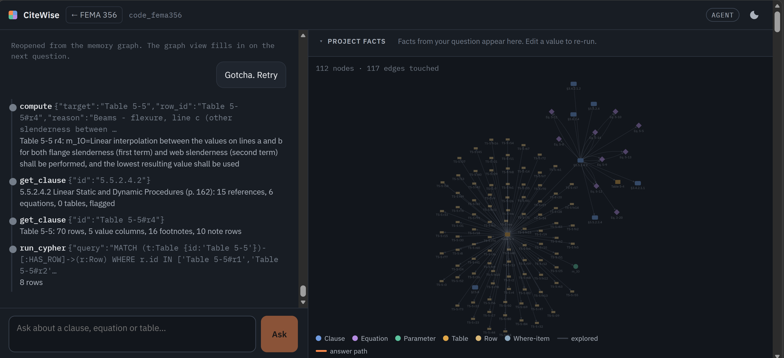
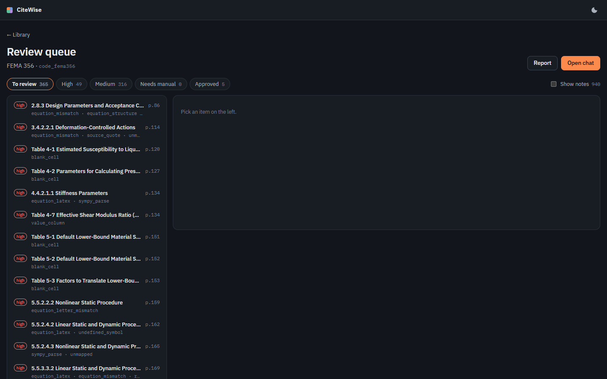
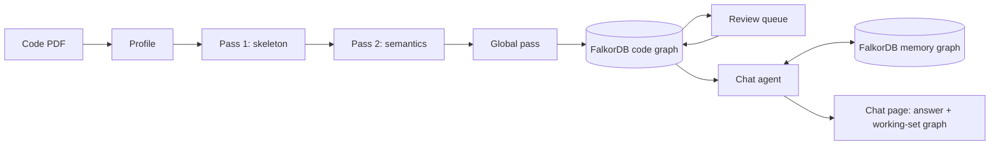

# CiteWise

**Ask any code a question. Every answer cited, every number checked.**



**Demo video:** https://youtu.be/QA0GnTvDuRo

Built for **Graph Hacks** (WeMakeDevs × FalkorDB), entered in all three tracks: Agents That
Act on Connected Data, Company Brain, and Agent Memory and Coordination.

---

## Why I built this

I'm a practicing structural engineer in California. Codes and standards are the backbone of my work, and they are also where AI tools have let me down the most. Traditional retrieval-based (RAG) agents chop a long code into chunks, and when they are handed large pieces of it they hallucinate: they blend provisions, misremember values, and cite the wrong clause, or none at all.

That matters because structural engineering decisions are public-safety decisions. An answer I can't trace back to the exact clause, table and equation is an answer I can't use. CiteWise keeps the code as a graph, so every answer comes with the path it walked and every number is computed by code, not by the model. A cited answer built on a graph is one an engineer can check, and that is what makes it possible to trust AI output on work that matters.

Nothing in it is specific to structural engineering. It works on any document built from cross-referenced provisions: mechanical, electrical, plumbing and architectural codes, fire codes, design standards, even an academic paper.

A building code is not a document you read top to bottom. It is a web: a clause sends you
to another clause, an equation needs a value from a table, a table row applies only under
the conditions in its label cells and footnotes, and commentary explains a provision
without changing it. A general-purpose chatbot asked a code question will often skip a
provision, invent or misremember a value, and it cannot show its work.

## What CiteWise does

- **The graph holds every fact.** Clauses, equations, tables, table rows, parameters,
  defined terms and the references between them are nodes and edges in FalkorDB. Each one
  keeps its page, a source quote, how it was extracted, and whether a person has reviewed it.
- **The agent walks the graph.** It finds the right entry points, follows dependencies,
  matches table rows to your situation, and plans multi-step procedures.
- **Every number comes from code.** Equations are evaluated in SymPy and table values are
  looked up by code. The AI never does arithmetic in its own text, and a checker flags any
  number in an answer that no tool produced.
- **You can see and check the path.** The chat page draws the nodes the agent touches as it
  works. Every citation opens the source: clause text, the equation image beside its
  LaTeX, the table row, the PDF page.

### A worked example

This is a real logged run on FEMA 356 (memory graph, session `a5f98884`). The agent made
38 tool calls.

> A 3-story concrete frame building on site class D with Ss = 0.6 and S1 = 0.25,
> fundamental period T = 0.45 s, weight W = 2,400 kips. Using the Linear Static Procedure
> for Life Safety, what is the pseudo lateral load V? Show every coefficient and where it
> comes from.

The chain of values, with the source each was saved under in the session:

| Value | Where it came from | Saved as |
| --- | --- | --- |
| W = 2,400 kips, T = 0.45 s, S<sub>S</sub> = 0.6, S<sub>1</sub> = 0.25 | Your question | from you |
| F<sub>a</sub> = 1.32 | Table 1-4 <!-- VERIFY -->, row for site class D, interpolated between 1.4 (S<sub>S</sub> = 0.50) and 1.2 (S<sub>S</sub> = 0.75), as the table note permits | inputs selected by agent |
| F<sub>v</sub> = 1.9 | Table 1-5 <!-- VERIFY -->, site class D, interpolated between 2.0 (S<sub>1</sub> = 0.2) and 1.8 (S<sub>1</sub> = 0.3) | inputs selected by agent |
| S<sub>XS</sub> = 0.792 | Equation 1-4 <!-- VERIFY -->, S<sub>XS</sub> = F<sub>a</sub> S<sub>S</sub>, computed by `compute` | inputs selected by agent |
| S<sub>X1</sub> = 0.475 | Equation 1-5 <!-- VERIFY -->, S<sub>X1</sub> = F<sub>v</sub> S<sub>1</sub>, computed by `compute` | inputs selected by agent |
| B<sub>S</sub> = B<sub>1</sub> = 1.0 | Table 1-6 <!-- VERIFY -->, the 5% damping row (5% damping assumed by the agent) | matched row |
| T<sub>S</sub> = 0.600 s | Equation 1-11 <!-- VERIFY -->, computed by `compute` | inputs selected by agent |
| S<sub>a</sub> = 0.792 | Equation 1-9 <!-- VERIFY -->, because T < T<sub>S</sub>, computed by `compute` | inputs selected by agent |
| C<sub>1</sub> = 1.15 (1.14982) | §3.3.1.3.1 <!-- VERIFY -->: 1.5 at T < 0.10 s, 1.0 at T ≥ T<sub>S</sub>, linear between | inputs selected by agent; the end values stated in §3.3.1.3.1 |
| C<sub>2</sub> = 1.0 | §3.3.1.3.1 <!-- VERIFY -->, for linear procedures | stated in §3.3.1.3.1 |
| C<sub>m</sub> = 0.9 | Table 3-1 <!-- VERIFY -->, "3 or more" stories, concrete moment frame column | inputs selected by agent |
| C<sub>3</sub> = 1.0 | §3.3.1.3.1 <!-- VERIFY -->, only if the stability coefficient θ < 0.1 | inputs selected by agent: the agent tried "assumed", and the fact-source check refused it because you had not accepted the value yet |

**Answer:** V = C<sub>1</sub> C<sub>2</sub> C<sub>3</sub> C<sub>m</sub> S<sub>a</sub> W by
Equation 3-10 <!-- VERIFY --> = **1,967.02 kips**. The answer closes by asking you to
confirm two assumptions: C<sub>3</sub> = 1.0, and that S<sub>S</sub> and S<sub>1</sub> are
already at your design hazard level. A follow-up in the same session ("How is this force
divided along the height? Each story is 15 feet tall") reuses those values and distributes
V by Equations 3-11 and 3-12 <!-- VERIFY -->.

## Quick start

### Prerequisites

- Git
- Python 3.12 (3.11 or newer works; the tests ran on 3.12.9)
- Docker Desktop (runs FalkorDB 4.22.1)
- An Anthropic API key with Console credits

**What it costs.** A chat answer cost between $0.016 and $0.148 across 23 logged answers;
19 of them cost under $0.06 (`data/reports/phase4_run*.log`, `phase6_*.log`,
`fa_interpolation2.log`). Pass 2 of FEMA 356 cost $6.06 and took 688 seconds in the logged
full run (`data/reports/fema356_full_pass2.json`). Loading the pre-built graph costs nothing.

### Windows

```powershell
git clone https://github.com/yUtkarsh/citewise.git
cd citewise
.\install.bat        # finds Python 3.11+, creates .venv, installs packages, copies .env.example to .env, pulls FalkorDB
notepad .env         # set ANTHROPIC_API_KEY
.\launch.bat         # starts Docker Desktop if needed, then FalkorDB, then the app at http://127.0.0.1:8000/
```

Then load the graph (path A below) from a second PowerShell window:

```powershell
.\.venv\Scripts\python.exe -m scripts.load_graph
```

`launch.bat` reads `APP_PORT` (default 8000) and opens your browser unless `NO_BROWSER=1`.

### macOS and Linux

```bash
git clone https://github.com/yUtkarsh/citewise.git
cd citewise
python3 -m venv .venv
source .venv/bin/activate
pip install -r requirements.txt
cp .env.example .env              # then set ANTHROPIC_API_KEY
docker compose up -d              # FalkorDB on :6379, its browser UI on http://localhost:3000
uvicorn app.api.main:app --port 8000
```

### After setup: two paths

**A. Load the pre-built FEMA 356 graph (no API cost).**

```bash
python -m scripts.load_graph
```

This restores the `code_fema356` graph from `export/` (12,928 nodes and 21,213 edges, with
search indexes and embeddings) and checks its checksum before loading and its node and edge
counts after. It then unpacks the equation, table and clause images
(`export/code_fema356_crops.zip`, 443 PNGs) into `data/crops/`, keeping files already
there. On our machine the restore took 1.0 seconds and the images another 1.0 seconds. It
refuses to overwrite an existing `code_fema356` unless you pass `--replace`. Open
http://127.0.0.1:8000/ and pick FEMA 356 from the library.

**B. Ingest your own PDF.** Use **Add a code PDF** in the library. CiteWise reads the page
map, the AI proposes a document profile (heading levels, caption and equation patterns,
running headers), and code validates it against the whole PDF. You check the profile, then
confirm to start Pass 1 (no API calls) and Pass 2 (one AI call per notation page, clause and
table). The upload then builds the search indexes (local embeddings, no API calls) and runs
the global pass (commentary linking, inferred links, entity resolution, graph checks); the
global pass logs its estimated cost before it starts. A progress view shows counts as they
arrive, and the ingestion report follows.

To try it on FEMA 356, download the PDF from the
[NIST NEHRP Clearinghouse](https://nehrpsearch.nist.gov/article/PB2009-105376/XAB) and place it at `data/fema356.pdf`, or upload it directly.

- **Cost cap.** Pass 2 and the global pass share one cap, `UPLOAD_MAX_COST` ($3 by default):
  the global pass gets what Pass 2 left. FEMA 356's Pass 2 alone cost $6.06, so raise the
  cap in `.env` for a code of that size.
- **Time.** FEMA 356's Pass 2 took 688 seconds (logged run above).
- **Running steps by hand.** The same steps run from the command line, for example to
  re-run the global pass with a higher cap:

  ```bash
  python -m app.graph.search_index --code <name>
  python -m app.ingest.global_pass --code <name> --dry-run   # prices the calls; drop --dry-run to run
  ```

Only digital PDFs with a text layer are supported.

### Troubleshooting

- **Docker is not running.** `launch.bat` starts Docker Desktop and waits for it; on other
  systems start Docker yourself, then `docker compose up -d`.
- **Port 8000 is in use.** Set `APP_PORT=8001` before `launch.bat`, or pass `--port 8001`
  to `uvicorn`.
- **FalkorDB is too old.** The graph needs FalkorDB 4.22.1 (graph module 42201) or newer;
  `scripts.load_graph` says so and stops. `docker compose pull` then `docker compose up -d`
  fetches the pinned image.
- **The first search or upload is slow.** The local embedding model
  (`BAAI/bge-small-en-v1.5`) downloads once on first use, then runs offline.
- **"cost cap reached".** Chat sessions stop at `CHAT_MAX_COST` ($1 by default), review
  re-runs at `REVIEW_MAX_COST` ($1), uploads at `UPLOAD_MAX_COST` ($3). Raise them in `.env`.
- **"No answer: …".** The agent always writes an answer; if its last call fails, the answer
  says why. Long procedure questions can use all `AGENT_MAX_TOOL_CALLS` (30); raise it in
  `.env`.

## A tour of the app

### Library



One card per ingested code. Open one to see its counts and its chats, and to chat, review,
or read its ingestion report. **Add a code PDF** starts an upload.

### Upload



Drop a PDF. The AI proposes the document profile and code validates it: coverage of the
text, heading order and hierarchy, references found. You check the title and heading
levels, then confirm. Pass 1, Pass 2, the search indexes and the global pass fill the graph
while counts update, and the
ingestion report shows what was found, what was flagged and what it cost.



### Chat



Ask a question. Each tool call streams in as a step, and the graph beside the chat lights
up with the nodes and edges the agent touches; the answer path turns bold. Citations in the
answer are chips: click one to open the source panel with the clause text, the equation
image beside its rendered LaTeX, the table row, or the PDF page. The facts panel lists every
value the session knows, with its source (from you, matched row, stated in a clause,
assumed, selected by agent). Edit a value and press Enter to re-run the last answer; it
leads with a change line such as `Changed: W 1500 → 2000 kips. V 1069.2 → 1425.6 kips`.

### Review



Everything the system was unsure about, highest severity first: flagged clauses and tables,
and the global pass's findings. Approve an item, or reject it with a note: the job re-runs
on the review model with your note, and the new answer replaces the old one only if it
passes every check. For a table whose grid is wrong, tick "The grid is wrong": the grid is
rebuilt from the image first, checked against every number in the text layer, and rolled
back if the new answer is not kept. Approving a global-pass proposal (an inferred link or a
merge) applies it.

## Questions to try

These worked well on FEMA 356 in the logged runs (`data/reports/phase4_run2.log`,
`phase6_questions.log`, `fa_interpolation2.log`, and the memory graph):

1. Pseudo lateral load for a building with C1=1.2, C2=1.1, C3=1.0, Cm=0.9, Sa=0.6,
   W=1500 kips? Then: *What if W is 2000 kips?*
2. Acceptance criteria for a reinforced concrete beam controlled by shear with stirrups at
   ≤ d/2?
3. What does Section 3.3.1.3 reference?
4. How is the pseudo lateral load distributed to the diaphragm at each floor level
   (Equation 3-13)?
5. What is Fa for site class C with Ss = 0.6?
6. What is the step-wise procedure for calculating the acceptance criteria for a concrete
   shear wall built in 1980? Then: *The wall is shear-controlled and I'm using the nonlinear
   static procedure for Life Safety. What's the acceptance limit?*
7. Which clauses are affected if the knowledge factor drops to 0.75?
8. The pseudo lateral load question in the worked example above, then: *How is this force
   divided along the height of the building? Assume each story is 15 feet tall.*

## How CiteWise checks itself

- **The profile validates itself.** The AI's proposed heading and caption rules are checked
  against the whole PDF (text coverage, heading order, hierarchy, reference coverage) and
  sent back for revision when a check fails.
- **Equations are checked two ways.** Each equation's LaTeX (read from the image) and its
  SymPy form must give the same values at sample points, and every symbol must be defined.
- **Table numbers must match the PDF.** Every number the AI reads from a table must be in
  the text layer. Where the text layer cannot be trusted, values are read from the image and
  checked by a second, independent read.
- **Footnote markers are not digits.** A footnote marker raised on a number in a table cell
  is stripped from the cell and attached to it, and a value that still ends in one is
  flagged.
- **The number guard.** After every answer, code checks that each number appears in a tool
  result, a saved fact or your own words (a rounding is accepted only if it keeps three
  significant digits). Anything else is shown as a warning under the answer.
- **Labels say how sure an answer is.** *Unreviewed* (a flagged item), *inferred* (a link
  the code implies but does not state), *assumed* (a typical value you accepted), *aligned by
  order*, *inputs selected by agent* (a value the agent picked), and *stated in §X* (a value
  stated in a clause's text). A label the answer leaves out is added in a footer.
- **Fact sources are checked.** A value is saved as "from you" only if you wrote that
  number, and as "assumed" only after you accepted it; otherwise it becomes "selected by
  agent".
- **The review queue.** Nothing flagged blocks the chat, but every flagged item is
  labeled in answers until a person approves it.
- **Pinning.** Each extraction answer is pinned. A re-run replaces a pinned answer only if
  the old one now fails a check and the new one passes, so a good answer is never lost.

## How it works

**Core principle: the AI decides what generalizes, code verifies, FalkorDB holds every
fact.** Claude (through the API) makes the judgments that need reading: the document's
heading rules, what a clause means, the symbols in an equation image, a table's structure.
Deterministic Python applies those judgments and checks every result before it is stored.



1. **Profile** (`app/profile/`). The AI reads a sample of pages and proposes the
   document's rules; code validates them against the whole PDF. No pattern from any one
   code is hard-coded.
2. **Pass 1, skeleton** (`app/ingest/pass1/`, no API calls). PyMuPDF and the profile split
   the PDF into clauses, equations (with image crops), tables (grids from PyMuPDF or
   Docling, with crops), figures, footnotes and references. Lines the font cannot decode are
   flagged. Writes use `UNWIND … MERGE`, so re-runs never duplicate.
3. **Pass 2, semantics** (`app/ingest/pass2/`). One validated AI call per notation page,
   clause and table, in parallel, cached by input, schema and prompt version. Clauses yield
   parameters, equations (LaTeX and SymPy), conditions, requirements, exceptions, typed
   references and symbol corrections; tables yield header parameters, row conditions and
   values, footnote rules and blank-cell readings. Every answer is checked; a failing one is
   retried once with the problems listed, then stored as flagged.
4. **Global pass** (`app/ingest/global_pass/`). Run after Pass 2 and the search indexes, on
   the whole graph:
   - *Entity resolution*: duplicate parameters found by embedding similarity and spelling,
     merged when their meanings match word for word, otherwise decided by the AI. Different
     units, different chapters' meanings, and ids that differ only by letter case are never
     merged automatically. A merged id keeps resolving to its survivor.
   - *Commentary linking*: commentary with no provision of the same number is linked to one
     by the AI, choosing among candidates found in code.
   - *Inferred edges*: tables and symbols no provision links to are linked to the provisions
     that need them; table columns are linked to the parameters they supply (inferred
     `GIVES`).
   - *Checks in Cypher*: parameters used but never defined, references to missing targets,
     and cycles among equations.

   Proposals at confidence 0.7 or higher are stored with `method: inferred`; the rest, and
   every check's hit, go to the review queue.
5. **Search indexes** (`app/graph/search_index.py`). Full-text indexes, and local
   sentence-transformers embeddings in FalkorDB vector indexes (no API).
6. **Chat agent** (`app/agent/`). Claude (`MODEL_AGENT`) with plain-Python tools over the
   code graph:

   | Tool | What it does |
   | --- | --- |
   | `find_entry` | Exact id, symbol and alias match, full-text and vector search, merged by rank fusion |
   | `get_dependencies` | Upstream (what a node needs) or downstream (what uses it) |
   | `applicable_clauses` | A clause and its sub-clauses, conditions checked against the session facts |
   | `get_clause` | Clause text, typed references, equations with crops; for a table: columns, row conditions, footnotes and notes (no values) |
   | `compute` | The only source of numbers: evaluates equations in SymPy from session facts; matches table rows, maps columns, interpolates when a footnote allows. With `resolve_inputs`, computes missing inputs through the graph when the facts leave no choice, and returns every intermediate value with its source |
   | `calculate` | For values `compute` cannot map: every input cited (a cell with its row, column, value and header, or a fact), every citation checked against the graph, arithmetic in SymPy |
   | `plan_procedure` | Ordered steps to a goal, dependencies first, with known and missing inputs and the decisions that change the path |
   | `save_session_facts` | Writes project facts to the memory graph, checking their source; a changed fact re-runs the last answer |
   | `trace` | Clause, table, row, equation and page citations for the answer path |
   | `run_cypher` | Read-only Cypher, 200 rows, 3-second timeout, code graph only; table values hidden |

   A question gets 10 tool calls, or 30 once the agent plans a procedure. With three left,
   the agent is told to wrap up; at the limit, a final call without tools writes the answer.
7. **Memory** (`app/memory/graph.py`). A separate FalkorDB graph holds sessions, messages,
   facts with their sources, matched table rows, and each answer's path. Reopening a chat
   restores all of it; a changed fact re-runs the stored path.

## Graph data model

One FalkorDB graph per code (`code_<name>`) and one memory graph (`memory`). Every code-graph
node carries `page`, `bbox`, `source_quote`, `confidence`, `extraction_method`,
`review_status` and `schema_version`; Pass 2 results also carry `status` (`skeleton`,
`extracted` or `flagged`) and `flags`.

The shipped FEMA 356 graph (`export/code_fema356.manifest.json`) has 1,883 clauses, 236
equations, 101 tables with 2,018 rows, 729 parameters, 237 terms and 3,012 references, out of
12,928 nodes and 21,213 edges. The document's 518 pages are 99.5% covered by the clause text
(the `Document` node's `coverage`).

**Code graph nodes**

| Label | What it is |
| --- | --- |
| `Document` | The code: title, edition, jurisdiction, page count, coverage |
| `Clause` | A numbered provision or commentary section: number, title, text (and corrected text), depth, stream |
| `Equation` | A numbered or inline equation: raw text, crop, LaTeX, SymPy form |
| `WhereItem` | One line of an equation's "where" block |
| `Parameter` | A symbol: id (also its SymPy name), LaTeX, description, units, aliases, notation scope |
| `Term` | A defined term and its definition |
| `Table` | Caption, pages, crops, trust (`text` or `image`) |
| `Row` | A grid row: Pass 1 cells and the footnote markers attached to them, Pass 2 conditions and values |
| `Footnote` | Marker, text, and its rule (interpolation, condition, override, note) |
| `Figure`, `ExternalCode` | Figures; codes referenced but not ingested (for example ACI 318) |
| `Condition`, `Requirement`, `Exception` | Parts of a clause, as Pass 2 read them |
| `SymbolCorrection` | Raw and corrected text where the text layer misread a symbol |
| `FlaggedLine` | A line the font could not decode, with its reasons |
| `Finding` | A global-pass item in the review queue: a check's hit, or a proposal below the confidence threshold |
| `MergedId` | The old id of a merged parameter, pointing to its survivor |

**Code graph edges**

| Edge | From → to | Meaning |
| --- | --- | --- |
| `PART_OF`, `NEXT` | Clause → Clause or Document | Hierarchy and reading order |
| `REFERENCES` {text, type} | Clause → Clause, Table, Equation, Figure, ExternalCode or Parameter | A reference; `type` is `requires`, `uses_value_from`, `modifies`, `exception_to`, `alternative_to` or `see_also` |
| `CONTAINS` | Clause → Equation, Table or Figure | Where an object is printed |
| `COMPUTES`, `USES` | Equation → Parameter | Left-hand side; right-hand-side inputs |
| `WHERE` | Equation or Clause → WhereItem | Definitions printed with the equation |
| `DEFINES`, `DEFINED_IN` | Clause → Parameter; Parameter → Clause | Where a symbol is defined |
| `GIVES` {cols, header_text, units} | Table → Parameter | A table column's quantity |
| `HAS_ROW` {index}, `HAS_FOOTNOTE`, `FOOTNOTE` | Table → Row or Footnote; Row → Footnote | Table structure |
| `HAS_CONDITION`, `HAS_REQUIREMENT`, `HAS_EXCEPTION`, `HAS_CORRECTION`, `HAS_FLAG` | Clause or Table → … | Clause parts, corrections, flagged lines |
| `USES_TERM` | Clause → Term | A defined term used in a clause |
| `COMMENTARY_ON` | Clause → Clause | Commentary section → provision |

Edges added by the global pass carry `method: inferred`, a `confidence` and a one-line
`reason`, and the agent labels them "inferred". In the shipped graph these are 25
`COMMENTARY_ON`, 23 `REFERENCES` and 20 `GIVES` edges (an inferred `GIVES` also names the
column it comes from, `via`).

**Memory graph**

```
(:Session {id, code})-[:HAS_MESSAGE]->(:Message {n, role, text})
(:Session)-[:ASSUMES {value, unit, source, label, clause}]->(:Parameter|:Descriptor {key, id, graph})
(:Session)-[:MATCHED {reason}]->(:Row {key, id, graph, table})
(:Session)-[:ASKED]->(:Question {text, answer, calls, tools, warnings})-[:ANSWERED_VIA {order}]->(stub)
```

Fact sources: `user`, `matched_row` (a value `compute` mapped from a matched row),
`from_clause` (a value stated in a clause, with the clause id), `assumed` (a typical value
you accepted) and `agent_selected` (a value the agent picked). Memory nodes point to
code-graph nodes by id; the agent never writes the code graph.

## Key Cypher queries

The fixed queries the product depends on. The agent's tools (`app/agent/`) run them
read-only; `run_cypher` uses FalkorDB's read-only mode.

Find candidates by full text and by vector, merged with exact matches by rank fusion
(`search.py`):

```cypher
CALL db.idx.fulltext.queryNodes('Clause', $q) YIELD node, score
RETURN node ORDER BY score DESC LIMIT 8

CALL db.idx.vector.queryNodes('Parameter', 'embedding', 8, vecf32($v)) YIELD node, score
RETURN node ORDER BY score ASC
```

What a parameter depends on, one hop at a time (`graph_tools.py`, `procedure.py`):

```cypher
MATCH (x:Equation)-[e:COMPUTES]->(n:Parameter {id: $id}) RETURN x, e
MATCH (x:Table)-[e:GIVES]->(n:Parameter {id: $id}) RETURN x, e
MATCH (n:Equation {id: $id})-[e:USES]->(x:Parameter) RETURN x, e
MATCH (n:Clause {id: $id})-[e:REFERENCES]->(x)
WHERE e.type IN ['requires', 'uses_value_from'] AND (x:Clause OR x:Table) RETURN x, e
```

What a change affects (downstream), for example "which clauses change if κ drops":

```cypher
MATCH (x:Equation)-[e:USES]->(n:Parameter {id: $id}) RETURN x, e
MATCH (x:Clause)-[e:REFERENCES]->(n:Equation {id: $id}) RETURN x, e
```

A table's value columns and rows for row matching; inferred `GIVES` edges are skipped so
columns read as printed (`compute.py`):

```cypher
MATCH (:Table {id: $id})-[e:GIVES]->(p:Parameter) WHERE coalesce(e.method, '') <> 'inferred'
RETURN p.id, coalesce(e.cols, [e.col]), e.header_text, e.units ORDER BY e.col
MATCH (:Table {id: $id})-[:HAS_ROW]->(r:Row) WHERE r.values IS NOT NULL RETURN r
```

Every source of a missing input, for `compute` with `resolve_inputs` (`chain.py`):

```cypher
MATCH (e:Equation)-[:COMPUTES]->(:Parameter {id: $id}) RETURN e.id, e.sympy ORDER BY e.id
MATCH (t:Table)-[e:GIVES]->(:Parameter {id: $id}) RETURN t.id, e.via, e.method ORDER BY t.id
```

A clause and its sub-clauses, with their conditions (`graph_tools.py`):

```cypher
MATCH (s:Clause {id: $id}) OPTIONAL MATCH (k:Clause)-[:PART_OF*1..4]->(s)
WITH s, collect(DISTINCT k) AS ks RETURN [s] + ks
MATCH (:Clause {id: $id})-[:HAS_CONDITION]->(x) RETURN x.text
```

Graph-wide checks (`global_pass/checks.py`): parameters used but never defined, and the
parameter dependencies searched for cycles:

```cypher
MATCH (e:Equation)-[:USES|COMPUTES]->(p:Parameter)
WHERE coalesce(p.source, '') <> 'notation' AND NOT ()-[:DEFINES]->(p) AND NOT ()-[:GIVES]->(p)
  AND NOT (p)-[:DEFINED_IN]->()
RETURN p.id, collect(DISTINCT e.id)

MATCH (a:Parameter)<-[:USES]-(e:Equation)-[:COMPUTES]->(b:Parameter) RETURN a.id, b.id, e.id
```

Storing an inferred edge without touching a stated edge between the same nodes
(`global_pass/edges.py`):

```cypher
UNWIND $rows AS r MATCH (a:Clause {id: r.src}) MATCH (b:Table {id: r.dst})
MERGE (a)-[e:REFERENCES {method: 'inferred'}]->(b) SET e += r.props
```

The facts block sent with every agent call (`memory/graph.py`):

```cypher
MATCH (:Session {id: $s})-[a:ASSUMES]->(n)
RETURN n.id, a.value, a.unit, a.source, a.label, a.kind, a.clause ORDER BY a.updated
```

## How it fits the tracks

**Agents That Act on Connected Data.** The agent does not retrieve passages; it walks a
graph. It follows `REFERENCES`, `USES`, `COMPUTES` and `GIVES` edges to find what an answer
depends on, matches table rows against your facts, and computes through the chain. The
chat page shows that walk as it happens.

**Company Brain.** A code is an organization's rulebook. CiteWise turns any digital code
PDF into a reviewed, queryable graph in which every fact keeps its page and source quote,
uncertainty is visible and routed to a person, and nothing is hard-coded to one document.

**Agent Memory and Coordination.** Each user's sessions, facts, matched rows and answer
paths live in a separate FalkorDB memory graph that points into the code graph. A changed
fact re-runs the stored path. Coordination happens between the agent, the review queue and
people: a reviewer's decision changes what the agent may rely on and how it labels answers.

## Tests

```bash
pytest -q                                   # 361 passed, 2 skipped in the latest run
RUN_SLOW=1 pytest -q tests/test_tables.py   # include the Docling test (PowerShell: $env:RUN_SLOW = "1")
```

Tests never call the API: Pass 2, the global pass and the agent run against scripted fake
models, on public fixture pages (`fixtures/`) and small invented graphs. Tests that use
FalkorDB skip when it is not running. Tests that need licensed pages (`private_fixtures/`) skip when the
files are absent. Most tests check document-independent behavior (ordering, coverage,
numeric matches, refusals) rather than strings from one code.

## Limitations

- **Digital PDFs only.** Scanned PDFs (no text layer) are not supported. Math in the text
  layer (primes, radicals, large brackets, stacked fractions) can extract wrongly, so
  equations and suspect table cells are read from images and checked.
- **Two-way table lookups go through `calculate`.** `compute` matches rows by their
  conditions but has no per-column conditions, so a value chosen by a column header (FEMA
  Table 1-4: F<sub>a</sub> by site class and S<sub>S</sub>) is read with `calculate`, which
  checks every cited cell, header and permitting note, and is labeled "inputs selected by
  agent".
- **Rules stated only in clause text are not equations.** C<sub>1</sub> in §3.3.1.3.1, for
  example, is a piecewise rule in prose: the agent saves its stated values and interpolates
  with `calculate`. `compute` also cannot evaluate equations that sum over floors (Equation
  3-12); the agent evaluates each floor with `calculate`.
- **Most commentary links wait for review.** Of FEMA's 129 commentary sections with no
  provision of the same number, 25 were linked; 104 are in the review queue (graph:
  `Finding` nodes of kind `commentary_link`).
- **Some walks stop short.** The global pass linked Table 6-3's columns to f'c, but no
  equation under §6.8 uses f'c in the graph, so a shear-wall procedure does not reach that
  table.
- **No unmerge action.** A merge keeps a snapshot of the removed parameter on its
  `MergedId` node, but undoing it is a manual graph edit.
- **The missing-reference check cannot tell other documents apart.** Most of FEMA's 131
  hits point to other documents' section numbers; they wait in the review queue.
- **Merged table cells can defeat a grid rebuild.** When one value spans several rows, the
  rebuilt grid repeats it while the extraction reads a blank; the new answer then fails and
  the grid is rolled back.
- **One user, no login.** The memory graph is single-user, and a chat session stays on the
  code it started on.
- The agent can only be as complete as the graph: when a link is missing it says so rather
  than answering from memory, and it may miss a step a person would take.

## Data and licenses

- **FEMA 356**, *Prestandard and Commentary for the Seismic Rehabilitation of Buildings*
  (Federal Emergency Management Agency, November 2000), is a U.S. federal government
  publication distributed free of charge by FEMA. The shipped graph (`export/`) and the demo
  use only FEMA 356. Single-page excerpts used as test fixtures are in `fixtures/`; the full
  PDF is not committed: download it from the [NIST NEHRP Clearinghouse](https://nehrpsearch.nist.gov/article/PB2009-105376/XAB) and
  place it at `data/fema356.pdf` to ingest it yourself.
- **No licensed code is part of this submission.** Licensed codes were used only locally,
  to test that the pipeline generalizes to other layouts. Their pages live in
  `private_fixtures/`, which is git-ignored, and nothing built from them (graph, images,
  cache, report) is committed.
- Embedding model: `BAAI/bge-small-en-v1.5` (MIT License), run locally.
- Libraries: FalkorDB, FastAPI, PyMuPDF, Docling, SymPy, sentence-transformers, Pydantic,
  Cytoscape.js and KaTeX, under their own licenses.

## AI-use disclosure

- **Built with Claude Code.** The code, tests and documentation were written with Claude
  Code (Anthropic), working from the spec in `SPEC.md` phase by phase, with the author
  reviewing plans, results and costs at each checkpoint.
- **The product uses the Claude API** (Anthropic) to propose the document profile, extract
  notation, clauses and tables in Pass 2, run the global pass's decisions, re-run rejected
  review items and rebuild table grids, and run the chat agent. Every output is validated
  with Pydantic and deterministic checks before it is stored, and every number in an answer
  comes from code.
- **The app says "AI"** wherever the AI acts, so you always know which parts are its
  judgment; the model ids show on hover.
- Embeddings are computed locally with sentence-transformers; no other AI service is used.

## My role

I designed CiteWise and directed its build; Claude Code wrote most of the code (see the AI-use disclosure above). My part:

- **The idea and the architecture.** Turning code PDFs into a graph; a two-pass pipeline where deterministic code segments the document and the AI extracts each clause into checked, structured data; a per-document profile instead of patterns hard-coded for one code; and FalkorDB as the store every answer is computed from.
- **The trust model.** Reading equations, tables and symbols from images where the PDF text layer fails, and deciding when to trust the text and when the image; keeping all arithmetic in code, including the `calculate` tool, where the AI prepares cited inputs and code does the math; and honest source labels on every saved fact.
- **Engineering verification.** Checking extractions and answers against the code by hand: equations, table rows, the default-material procedure for older buildings, and the full pseudo lateral load chain. Problems found this way became general checks, not one-off patches.
- **Generalization.** Rejecting fixes that only worked for one document, and testing on a second code layout and on a holdout code the pipeline had never seen.
- **The user workflow.** How an engineer moves through the app, step by step: a library of codes, each with its own page and list of past chats; upload with a profile the engineer confirms before anything is spent, live progress and an ingestion report; one code per chat; a review queue that shows what needs attention first (high and medium severity by default, notes behind a toggle), where flagged items stay usable but labelled until reviewed and a reject sends the item back to the AI with the engineer's note; and a chat page with the live graph, citations that open their source, and an editable facts panel grouped by where each value came from, where changing a value re-runs the answer with a one-line summary of what changed.
- **Product decisions.** Grid rebuilds from the review queue, commentary linking and inferred links, cost estimates and caps before spending, and the scope and cost trade-offs throughout.

## Reference

### Configuration (`.env`)

`.env` is never committed. The app loads it with python-dotenv; do not export the API key in
your shell.

| Variable | Default | Used for |
| --- | --- | --- |
| `ANTHROPIC_API_KEY` | | Claude API |
| `MODEL_PROFILE`, `MODEL_NOTATION`, `MODEL_TABLES` | `claude-sonnet-5-5` | Profile, notation pages, tables |
| `MODEL_CLAUSES` | `claude-haiku-5-5` | Clause extraction, commentary linking |
| `MODEL_AGENT`, `MODEL_REVIEW` | `claude-sonnet-5-5` | Chat agent; review re-runs and grid rebuilds |
| `MODEL_GLOBAL` | `MODEL_REVIEW` | Global pass: inferred edges and merge decisions |
| `AGENT_EFFORT` | `medium` | Agent effort |
| `AGENT_MAX_TOOL_CALLS`, `AGENT_MAX_TOOL_CALLS_SIMPLE` | 30, 10 | Tool calls per procedure question and per other question |
| `CLAUSE_CROPS` | `always` | Send clause images with every clause call, or only for flagged lines |
| `EMBED_MODEL` | `BAAI/bge-small-en-v1.5` | Local embeddings (downloaded once, then offline) |
| `FALKORDB_HOST`, `FALKORDB_PORT` | `localhost`, `6379` | FalkorDB |
| `CHAT_MAX_COST`, `REVIEW_MAX_COST`, `UPLOAD_MAX_COST` | 1.0, 1.0, 3.0 | USD caps per chat session, per reject, per upload |

### Command line

```bash
uvicorn app.api.main:app --reload                                    # the web app
python -m scripts.load_graph [--replace]                             # load the shipped FEMA 356 graph and images
python -m scripts.export_graph --code fema356                        # export a graph, its manifest and images
python -m app.ingest.run data/fema356.pdf --pass1                    # profile + skeleton
python -m app.ingest.run data/fema356.pdf --pass2 --max-cost 9       # semantics (--dry-run estimates)
python -m app.graph.search_index --code fema356                      # full-text and vector indexes
python -m app.ingest.global_pass --code fema356 --dry-run            # global pass (parts: resolve,commentary,inferred,gives,checks)
python -m app.agent.chat --code fema356 --max-cost 1                 # chat in the terminal
python -m app.agent.chat --code fema356 --script scripts/phase4_questions.txt
python -m scripts.recheck_tables data/fema356.pdf                    # re-run table checks, no API calls
python -m scripts.fix_cell_markers --code fema356                    # footnote markers glued to numbers
python -m scripts.cleanup_orphans --code fema356 --dry-run           # leftover parameters
```

Useful Pass 2 options: `--pages 120-140`, `--chapters 2,3`, `--tables "Table 6-7|Table 6-19"`,
`--clauses`, `--jobs notation,definitions,clauses,tables`, `--redo`, `--no-cache`, `--hint`.

### Repository layout

```
app/
  profile/      document profile: page map, AI proposal, validation
  ingest/       pass1/ (skeleton), pass2/ (semantics, checks, grid revision), global_pass/
  graph/        FalkorDB connection, schema, writers, merges, search indexes
  agent/        tools, compute, chained compute, calculate, procedure, loop, guard, CLI, web hook
  memory/       memory graph
  api/          FastAPI routes: chat (SSE), library and ingestion, sessions, review
  prompts/      one versioned file per AI prompt
web/            static pages (Cytoscape.js, KaTeX); web/EVENTS.md is the chat event contract
scripts/        graph export/load, fixtures, font check, table recheck, cell markers, orphan cleanup
export/         the FEMA 356 graph as a FalkorDB dump, its manifest and its images
tests/          pytest suite with fake models and invented graphs
fixtures/       public FEMA 356 pages
install.bat, launch.bat   Windows setup and launch
SPEC.md         the full spec, build order and known issues
```
